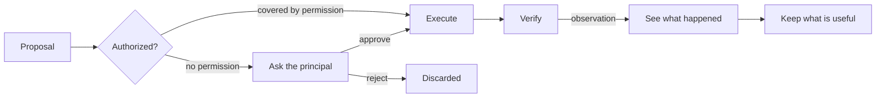
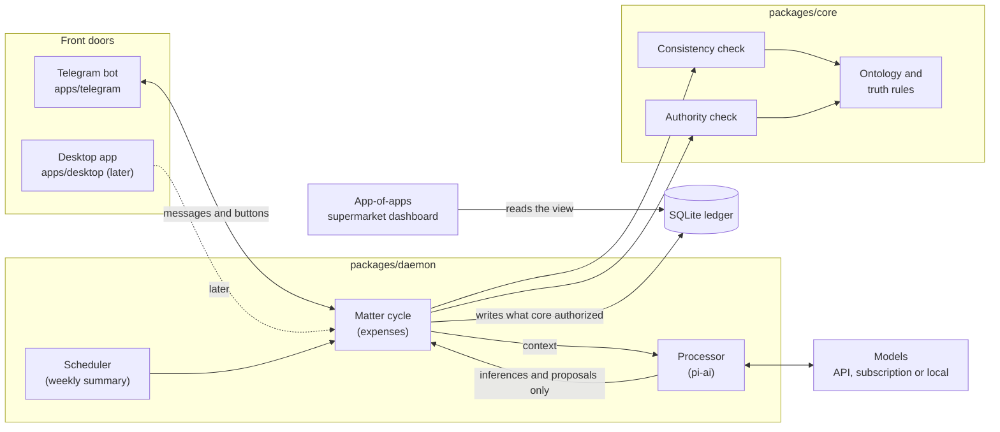

# PRD: ANOMANDER

> **A personal assistant that understands your world, knows what is true, knows what it may do, and carries a matter to a verifiable result.**

| | |
| --- | --- |
| Version | 0.2.0-draft |
| Author | Eric Marès |
| Date | 2026-10-30 |
| Status | Draft, in implementation (M0 to M3b built, §17) |
| License | MIT |
| Repository | Public monorepo, `Sitray/anomander` |

---

## 0. How to use this PRD with Gentle AI

This document is the product source of truth. Requirements are numbered (`R-#`) and user-facing strings are quoted verbatim in §12 so they can be copied as-is into ODD feature documents.

- Each milestone in §17 is one substantial feature. Under ODD, the agent creates `odd/tasks/<feature-name>.md` for it before the first source write. Feature documents are working notes: `odd/` is git-ignored and never published. Suggested feature names are listed in §18.
- In each feature document, `## Specs` should quote the relevant `R-#` requirements, their acceptance criteria and the §12 strings verbatim. Do not paraphrase them.
- The design rationale lives in `docs/`, written from §5 to §11 of this PRD. If this PRD and `docs/` disagree, this PRD wins until `docs/` is updated in the same change.
- Test-first applies: every `R-#` has acceptance criteria that can be turned into a RED test.

---

## 1. Problem statement

AI assistants can talk about anything, but they do not know what is true about their user, and they do not know what they are allowed to do.

- **They mix kinds of truth.** What the user said, what a document claims, what the model guessed and what was verified all end up in the same "memory". After a few months nobody can tell which facts are reliable.
- **They confuse confidence with permission.** A model that is "very sure" acts as if it were authorized.
- **Tools define the system.** With a vector database everything becomes "memory"; with a task app everything becomes "tasks"; with MCP servers the available tools decide what the assistant is. Change the model and the assistant loses its identity, memory and rules: it was a wrapper around an LLM.

## 2. Vision

ANOMANDER is a personal assistant you can talk to about almost anything and that understands you. "Understanding" has three layers, each built differently:

| Layer | What it means | Where it comes from |
| --- | --- | --- |
| Converse | Talk about any topic: questions, explanations, ideas | The model, from day one |
| Know me | Know who I am, what I want and what I told it, separating what I said from what it inferred | The ontology and a truth store with epistemic modes |
| Act for me | Carry matters to a verifiable result, within the permissions I grant | Capabilities and permissions, one matter at a time |

Design direction, never reversed: **world and ontology → truth and authority → capabilities and operations → providers → concrete apps, APIs and models.**

The first version delegates **one matter end to end: keeping track of my expenses.** I send a receipt photo (or write "23 € cena") and ANOMANDER understands it, organizes it and records it without me administering anything. Starting with one matter limits what it does, not what you can talk to it about.

## 3. Target users

- **Primary:** the principal, the single person an ANOMANDER installation serves. Telegram is the first channel; desktop comes last.
- **Secondary:** developers who self-host their own ANOMANDER from the open-source repository. One installation serves exactly one principal.

## 4. Goals and non-goals

### Goals (v1)

- G1. Register expenses from text messages and receipt photos sent over Telegram, with every stored fact carrying its epistemic mode and provenance.
- G2. Ask the principal only when a receipt does not check out, a merchant is new, or a decision is required.
- G3. Expose supermarket purchases (product, quantity, price, merchant, date) with the mode of each expense, through a stable read-only view for the "app of apps" dashboard.
- G4. Send a weekly summary whose figures are computed by code and traceable to each expense.
- G5. Keep the model replaceable: switching between API, subscription and local models requires configuration only.
- G6. Answer open conversation from day one.
- G7. Remember the lasting facts the principal tells it in open conversation, each with its mode and provenance, use them only to converse, and forget them for real when asked.

### Non-goals (v1)

- Multi-user installations.
- Moving money: payments, transfers or any banking write access. These operations do not exist.
- Price tracking, subscriptions, budgets, bank connections, web dashboard, desktop app, voice and computer control (later matters, §17).
- Storing receipt images beyond what R-8 allows.
- Reading PDFs, voice notes or any input other than text and images (R-20).
- External read access to the ledger from other applications (an API or an MCP server for the AI assistant). It comes after the Telegram bot; until then the `supermarket_purchases` view is the only contract.

## 5. Design principles

1. **The model is a processor, not the system.** Claude, Gemini, DeepSeek or a local model are replaceable. Identity, memory and rules live outside them.
2. **Every assertion carries its epistemic mode.** Observed, declared, inferred and confirmed never mix. An inference does not become a fact because it was stored.
3. **Capability is not permission.** Being technically able to do something does not authorize doing it. Authority comes from the principal, never from the model's confidence.
4. **Apps implement capabilities; they do not define them.** "Send a Telegram message" does not exist in the ontology; "notify the principal" does, and Telegram is one way to do it.
5. **Only what deserves to survive survives.** Execution context dies with the execution; what is kept has a reason and an expiry.
6. **Minimum sufficient.** Each class exists because the workflow needs it. Infrastructure is added only when a real matter requires it. One process and one SQLite file are enough for v1.

## 6. Ontology

26 classes in six layers. 16 are **data** (persisted); 10 are **vocabulary** (design concepts, not tables).

| Layer | Class | Meaning | In the expenses workflow | Kind |
| --- | --- | --- | --- | --- |
| World | Principal | The person ANOMANDER serves; the only source of authority | Me | Data |
| World | External entity | Something outside ANOMANDER that acts or informs: a merchant, a bank, another person | Mercadona | Data |
| World | Document | An object containing someone else's claims; not true by itself | A receipt photo | Data |
| World | Expense | An economic fact: I paid an amount to someone on a date | 23,40 € at Mercadona on 29 October | Data |
| World | Purchase line | A product within an expense: name as printed, quantity, amount | "LECHE ENTERA 1L × 2, 1,78 €" | Data |
| World | Category | A class of expense in my own scheme, defined by me | Supermercado, restaurantes | Data |
| Truth | Assertion | A statement that something is so at a point in time, with its mode | "The receipt total is 23,40 €" | Vocabulary |
| Truth | Observation | An assertion recorded directly from a source, uninterpreted | "Received this image at 21:05" | Data |
| Truth | Declaration | An assertion someone made; worth what its author is worth | "23 € cena" | Data |
| Truth | Inference | An assertion produced by a processor, with basis and confidence | "Total is 23,40 €", read from the photo | Data |
| Truth | Confirmation | An act that validates an assertion: by the principal, or by a deterministic check that corroborates it | "Yes, that's right"; lines sum to the total | Data |
| Truth | Source | Where an assertion came from, with its reliability | My message; the receipt | Vocabulary (a field) |
| Work | Goal | A state of the world the principal wants | Know what I spend each month | Vocabulary |
| Work | Preference | A lasting constraint on how to reach it | Weekly summary on Sundays | Vocabulary |
| Work | Matter | A goal delegated to ANOMANDER, with its own state; the unit of delegation | "Keep my expenses" | Data |
| Work | Pending decision | A question only the principal can answer | "Is the total 23,40 € or 28,40 €?" | Data |
| Knowledge | Policy | A rule declared by the principal about how ANOMANDER behaves | "Mercadona is always supermercado" | Data |
| Knowledge | Pattern | An inferred generalization; a proposal until the principal turns it into a policy | "You always file Mercadona as supermercado" | Vocabulary (v1) |
| Operations | Capability | A kind of thing ANOMANDER can do, without naming how | Read a document | Vocabulary (code) |
| Operations | Permission | A grant from the principal: capability, scope, conditions, limits, expiry | Register without asking if lines sum to the total | Data |
| Operations | Proposal | An action ANOMANDER wants to take and has not taken | "Register 23,40 € at Mercadona as supermercado" | Data |
| Operations | Action | An executed operation, with who authorized it | The registered expense | Data |
| Runtime | Execution | One cycle with a start and an end | Processing one receipt | Vocabulary |
| Runtime | Working context | What matters only during an execution; dies with it | Raw extracted text, intermediate reasoning | Vocabulary |
| Runtime | Processor | Code or a model that transforms information; produces only inferences and proposals | A vision model reading the receipt | Vocabulary |
| Runtime | Provider | A concrete implementation of a capability | Telegram; the vision model | Vocabulary |

There is no "Result" class: the result of an action is an **observation** about that action. There is no "Memory" class: memory is the set of assertions and policies that survive, each with its mode and expiry.

**Key insight for this matter:** a receipt is not an expense. It is a document that *claims* an expense happened. What ANOMANDER extracts from it is inference until something confirms it.

## 7. Truth and provenance

### 7.1 Who owns each truth

| Class | Principal | External source | Deterministic code | Processor (LLM) |
| --- | --- | --- | --- | --- |
| Observation | Does not create | Originates | Records | Never |
| Declaration | Creates | Creates (as a third party) | Records | Never on anyone's behalf |
| Inference | May refute | No | May produce (calculations) | Produces |
| Confirmation | Gives | Only with authority over that datum | Corroborates (checks) | Never |
| Goal, preference, policy | Creates, changes, retires | No | Stores | Only proposes |
| Matter | Opens and closes | No | Tracks state | Proposes state changes |
| Pending decision | Answers | No | Raises | Formulates |
| Permission | Grants, limits, revokes | No | Checks | Never, not even for itself |
| Action | Authorizes (or a permission covers it) | No | Executes and verifies | Proposes |

Rules:

1. **The LLM does not observe.** The receipt photo is an observation; the total the model reads from it is an inference, however confident.
2. **An inference is promoted in exactly two ways:** the principal confirms it, or a deterministic check corroborates it (lines sum to the total, the date is valid). Storing it changes nothing.
3. **Nobody grants authority to themselves.** Neither the LLM nor code creates permissions; they only check them.
4. **On my own expenses, my declaration rules.** If I write "23 € cena", the amount is mine and needs no further proof. The category is still an inference unless I state it or a policy of mine yields it.

### 7.2 Required provenance fields

Every stored assertion has: **mode** (observed, declared, inferred, confirmed), **actor** (principal, source, code, processor), **source**, **valid_at** (when it was true), **basis** and **confidence** (for inferences), **expires_at**, and **status** (current, confirmed, refuted, expired). Without these fields an assertion is not stored.

**How a confirmation is stored.** A confirmation is a new assertion with mode `confirmed` and `confirms_id` pointing at the assertion it validates; the validated assertion's `status` becomes `confirmed`. Its actor says who confirmed it:

- `principal`: the principal confirmed it (for example, pressing "Apuntar").
- `code`: a deterministic check corroborated it. `basis_json` names the checks that passed, for example `{"checks": ["lines_sum_to_total", "valid_date", "no_duplicate"]}`.

A corroboration is therefore a confirmation by code. The word "corroborated" exists only as an expense `mode`, meaning every inference behind the expense was confirmed by code and none by the principal.

### 7.3 Lifecycles

- **Assertion:** born in its mode. An inference can become confirmed, refuted or expired. It never changes mode silently. Corrections create a new assertion that supersedes the old one.
- **Matter:** open → active → waiting (on a pending decision) → resolved or abandoned. Only the principal opens and closes it. Matters do not expire in v1.
- **Permission:** granted → active → revoked or expired. Revocable at any time.
- **Action:** see §8.2.

## 8. Authority

### 8.1 Levels

| Level | Allows | Who decides each case | Examples |
| --- | --- | --- | --- |
| Free | Read, observe, infer, propose | Nobody: nothing outside ANOMANDER changes | Read the receipt; propose a category |
| With permission | Actions covered by an active permission, within its limits | Code checks the permission | Register an expense whose lines sum to its total; send the Sunday summary |
| With confirmation | Change or delete something of mine, contact third parties, any action no permission covers | The principal, case by case | Register a receipt that does not add up; correct or delete an expense |
| Forbidden | Move money, grant permissions, act on my behalf towards others | Nobody: the operation does not exist | Pay, transfer, complain to a merchant |

**Confidence is not permission.** Confidence answers "is it true?"; permission answers "may you do it?". That is why the starting permission does not say "if you are sure" but "if the lines sum to the total": a condition code can check. Confidence decides whether ANOMANDER proposes; permission decides whether it acts. Forbidden operations are not rules the model must respect: they do not exist.

### 8.2 Action lifecycle



The authority check is code, never a model step. Verifying means observing what actually happened, not assuming the action worked.

## 9. Capabilities and operations

| Capability | Operation | Input | Output | Level |
| --- | --- | --- | --- | --- |
| Understand the principal | Interpret a message | My text ("23 € cena") | The literal declaration, plus proposed amount, merchant and category | Free |
| Read documents | Extract receipt data | A receipt photo | Inferences: merchant, date, lines, total, payment method | Free |
| Classify expenses | Assign a category | A proposed expense, my categories, my policies | Category: derived from a policy or inferred | Free |
| Consult the principal | Raise a decision | A question and its options | Pending decision; my answer returns as a declaration or confirmation | Free |
| Register expenses | Register, correct or delete an expense | A proposal | The expense in my ledger, with mode and provenance | Register: with permission if it checks out, else with confirmation. Correct and delete: with confirmation |
| Inform the principal | Send a summary or notice | Expenses for a period | Action, then an observation of delivery | With permission |
| Manage matters | Open, pause or close a matter | My declaration or an ANOMANDER proposal | Matter state change | With confirmation if ANOMANDER proposes it |

Internal deterministic operations (not capabilities, nobody requests them): **check consistency**, **check authority**, **retain** (decide what survives an execution).

## 10. First workflow: keeping my expenses

Example: I send a Mercadona receipt photo over Telegram. A text message such as "23 € cena" follows a shorter path: the processor interprets the text (step 2), code checks that the amount it extracted appears literally in my message (R-2 AC6), and the receipt checks of step 3 do not apply, because the amount is my declaration.

| Step | What happens | What is created or changed | Who decides |
| --- | --- | --- | --- |
| 1. Observe | The photo arrives | Observation: the image, source "principal message", time | Nobody |
| 2. Interpret | The processor reads the receipt | Inferences: merchant, date, lines, total, payment method, with basis | Processor (proposes) |
| 3. Check consistency | Code sums the lines, validates the date, looks for duplicates | If all checks pass, inferences are corroborated; otherwise the failing check is recorded | Code |
| 4. Relate to my state | Looks up a policy for the merchant; otherwise infers the category | Category from a policy, or inferred | Code and processor |
| 5. Decide | Proposes registering the expense | Proposal | Processor (proposes) |
| 6. Check authority | Does the "register if it checks out" permission cover it? | If it checks out and the category comes from a policy: authorized action. Otherwise: pending decision with buttons | Code; the principal if needed |
| 7. Act | Registers the expense and its lines | Executed action; current expense with provenance | Code |
| 8. Verify | Reads the record back and replies with what was recorded | Observation about the action; confirmation message | Code |
| 9. Retain | Decides what survives | See below | Code |
| 10. Inform (Sundays) | Summarizes the week by category | Action under permission; totals computed by code, the model only writes the text | Code and processor |

**Survives:** the expense with its mode and provenance; its purchase lines (they feed the supermarket dashboard); my declarations, confirmations and corrections (a correction refutes the earlier inference, it does not delete it); inferences that ended in a registered expense (others expire after 30 days); a proposed pattern, if any, marked as a proposal.

**Dies:** the receipt photo (deleted as soon as data is extracted), raw extracted text, intermediate reasoning and any unused inference. Without the photo a misread receipt cannot be re-read; this is an accepted trade-off.

**Success test:** I send the photo and do nothing else. ANOMANDER only asks when the receipt does not add up or the merchant is new, and on Sunday I get a summary whose figures I can trace to each receipt.

## 11. Functional requirements

Initial configuration, decided by the principal:

- Starting permission: **register without asking if the lines sum to the total and the category comes from one of my policies.**
- Initial categories: **supermercado** and **restaurantes**. Anything else is stored without a category until the principal creates one (R-18).
- Receipt images are not stored.
- Bot language: Spanish (`es-ES`). All user-facing strings live in one module so they can be translated.

### R-1 Principal-only access
The bot processes messages only from the principal, in a private chat.
- AC1: A message is processed only when the chat type is `private` and both the chat ID and the sender's user ID equal `ANOMANDER_PRINCIPAL_CHAT_ID`. Any other message, including the principal's messages in a group, gets no reply and creates no rows in any table.
- AC2: The ignored message is logged with its chat ID and sender ID at `warn` level.

### R-2 Text expense
A message stating an amount registers a declared expense. The processor interprets the text; code checks the amount against the literal message.
- AC1: "23 € cena" creates an expense with `total_cents = 2300`, `mode = 'declared'`, `document_id = NULL`, and a `declared` assertion for the amount with actor `principal`.
- AC2: Registering what the principal declared is authorized by the principal's own message; no permission lookup is required for the amount.
- AC3: If the category comes from a policy or the principal states it, `category_basis` is `'policy'` or `'declared'`; otherwise it is `'inferred'` and the category must be one of the existing categories or `NULL`.
- AC4: The reply follows string S-1 (or S-2 when there is no merchant), phrased as in R-21.
- AC5: Amounts written as `23`, `23,40`, `23.40`, `23€`, `23 €` and `€23` are understood. These forms are the contract test cases for the text interpreter (recorded responses) and the inputs of the AC6 check.
- AC6: The processor returns the amount, and optionally the merchant, date and category, as inferences. Code accepts the amount only if it equals one of the amounts written literally in the message, normalized with the AC5 forms. Otherwise no expense is created and the reply is S-16.
- AC7: The date is today in `TZ` unless the message names another one ("ayer", "el lunes"), which the processor infers. A date later than today is rejected as in R-4 AC2: no expense is created and the reply is S-21.

### R-3 Receipt photo
A photo is read by the document processor and becomes a proposal.
- AC1: A `documents` row of kind `'receipt'` and an `observed` assertion for the received images are created.
- AC2: The processor returns merchant, date, lines (name, quantity, amount) and total as `inferred` assertions with `basis_json` and `confidence`. Processor output is validated with Zod; invalid output counts as unreadable.
- AC3: If the receipt cannot be read, the reply is S-5 and no expense is created.
- AC4: An album (several photos with the same Telegram `media_group_id`) is one receipt with several images, read together in one processor call. The Telegram front door collects the album's photos for 2 seconds after the first one arrives and hands them to the daemon as one receipt.
- AC5: A caption on the photo is a declaration of the principal, sent to the processor with the images. A category or merchant stated in it has `category_basis = 'declared'` and wins over the receipt.

### R-4 Consistency checks
Code checks every proposed receipt expense.
- AC1: Lines must sum exactly to the total in cents.
- AC2: The date must be a valid date not later than today in the configured time zone.
- AC3: A duplicate is an existing current expense with the same merchant, date and total.
- AC4: When AC1 and AC2 pass and AC3 finds nothing, code creates one `confirmed` assertion with actor `code` for each extracted inference (§7.2), each inference's `status` becomes `confirmed`, and the expense `mode` is `'corroborated'`.
- AC5: Property test: for any generated list of lines and total, the check accepts if and only if the lines sum to the total.

### R-5 Categorization
- AC1: An active policy for the merchant yields its category with `category_basis = 'policy'`.
- AC2: Without a policy, the processor may infer one of the existing categories (`category_basis = 'inferred'`) or none.
- AC3: The processor can never create a category.

### R-6 Authority check
- AC1: A receipt expense that passed R-4 and has `category_basis = 'policy'` is registered without asking, with `actions.authorized_by = 'permission:<id>'`.
- AC2: Any other receipt expense creates a pending decision. Lines that do not add up use S-3; a duplicate uses S-4; a new merchant or an inferred category uses S-6; a date after today uses S-33.
- AC3: Buttons are exactly "Apuntar", "Corregir" and "Descartar" (S-4 uses only "Apuntar" and "Descartar").
- AC4: "Apuntar" registers with `authorized_by = 'principal'` and a `confirmed` assertion. "Descartar" marks the proposal `rejected`, refutes the pending expense so no current expense remains, and replies S-23.
- AC5: The authority check is a pure function in `packages/core` with unit tests for every level in §8.1.

### R-7 Corrections
- AC1: "Corregir" replies with S-7 and waits for the principal's text.
- AC2: A correction creates a `declared` assertion with `supersedes_id` pointing at the corrected one, marks the old one `refuted`, updates the expense, and replies with S-8. It may change the total, the merchant, the category or the date. The processor resolves a named date against today in `TZ`; code keeps it only if the words it rests on are in the message and it is not after today, and otherwise ignores it like any value not written.
- AC3: No row in `assertions` is ever updated except `status`, or deleted. SQLite triggers enforce it (§13): any other update or any delete aborts with an error, and an integration test proves both.

### R-8 Image retention
- AC1: The images are deleted from disk as soon as extraction finishes (successfully or not), `documents.status` leaves `'queued'` and `documents.image_deleted_at` is set.
- AC2: Exception: if the daily AI budget is exhausted (R-12), the document stays `'queued'` with its images on disk and `keep_until` set to 24 hours after `received_at`.
- AC3: If a queued receipt is still unread 1 hour before `keep_until`, the principal receives S-13 with buttons "Sí" and "No".
- AC4: "Sí" extends `keep_until` until the receipt is read, up to 7 days after `received_at`, and replies S-24 with that last day. "No", or no answer, leaves `keep_until` as it is; "No" replies S-25.
- AC5: When `keep_until` passes with the receipt still unread, the retention job (R-19) deletes the images, sets `documents.status = 'discarded'` and sends S-14. A receipt is never deleted unread without telling the principal.

### R-9 Verification reply
- AC1: After registering, code reads the expense back from the database and builds the reply from the stored row, not from the proposal.
- AC2: The reply follows S-1 or S-2 (R-21), and its delivery is recorded as an observation linked to the action (`verification_assertion_id`).

### R-10 Weekly summary
- AC1: Sent on Sundays at the time set by `ANOMANDER_WEEKLY_SUMMARY_CRON` (default `0 20 * * 0`) in `TZ` (default `Europe/Madrid`).
- AC2: Totals per category and the number of unconfirmed expenses are computed in code. The model may only write the surrounding text.
- AC3: The message follows S-9; every figure in it equals the sum of the corresponding rows.
- AC4: `{desglose}` lists every existing category as `{Categoria} {importe}`, joined by ` · `, sorted by amount from highest to lowest, with `Sin clasificar {importe}` always last. Categories with no expenses that week show `0,00 €`.

### R-11 Supermarket view
- AC1: The view `supermarket_purchases` returns exactly the columns `producto`, `cantidad`, `precio_cents`, `comercio`, `fecha` and `modo`, for current expenses in the category `supermercado`.
- AC2: A newly registered supermarket expense appears in the view with no further action.

### R-12 Daily AI budget
- AC1: `ANOMANDER_DAILY_AI_CALL_LIMIT` caps processor calls per day (default 200).
- AC2: When the cap is reached, the processor is not called, the receipt is queued (R-8 AC2), and the principal receives S-10 once that day.
- AC3: When the day changes in `TZ`, queued receipts are processed in arrival order, counting against the new day's cap.
- AC4: When the cap is reached, a principal text that needs the processor (an expense, a conversation or a correction) is not interpreted, nothing is stored, and the reply is S-26.

### R-13 Policies
- AC1: A message such as "Mercadona es supermercado" proposes a policy; it is stored only after the principal confirms with S-11.
- AC2: A pattern noticed by the processor is only ever offered as a proposal (S-12); it never becomes a policy without confirmation.

### R-14 Processor isolation
- AC1: The processor never writes to the database. It returns inferences and proposals; only deterministic code persists rows: `packages/core` decides, and the daemon stores what it decided.
- AC2: Any processor output claiming mode `observed`, `declared` or `confirmed` is rejected and logged.
- AC3: The processor is called through `@earendil-works/pi-ai` (`complete()` with text and image content) and is given no tools: no shell, no file system, no payments, transfers, permissions or deleting data. A test asserts that no processor call passes tools.

### R-15 Replaceable providers
- AC1: The model is chosen with `ANOMANDER_MODEL` and `ANOMANDER_VISION_MODEL` (provider-qualified IDs such as `openai/gpt-…` or a local `ollama/…` entry); changing them requires no code change.
- AC2: `packages/core` imports nothing from `packages/daemon`, any app, or any provider SDK. A boundary test enforces it.

### R-16 Open conversation
- AC1: A message that is not an expense, a policy or an answer to a pending decision gets a conversational reply.
- AC2: Open conversation persists nothing except the memories of R-23.
- AC3: The text interpreter receives the recent turns of the conversation, oldest first, at most the last 10 and none older than 30 minutes. A turn is each principal text, receipt (as `[foto de ticket]` and its caption) or button press (as `[botón: {opción}]`) with the reply that was sent, and each message sent to the principal unasked. Turns are kept only in the daemon's memory, never written to the database or logged, and lost on restart; a confirmed forget (R-23 AC6) empties them.

### R-17 Message routing
Every incoming message has exactly one destination, decided by code in this order.
- AC1: A button press carries its pending decision ID in the callback data and goes to that decision. If the decision is not `open` or `awaiting_text`, the reply is S-19 and nothing changes.
- AC2: A text sent as a Telegram reply to a decision's message is a correction for that decision (R-7).
- AC3: Otherwise, if a decision is `awaiting_text`, the text is a correction for it. At most one decision is `awaiting_text` at a time: pressing "Corregir" on another decision moves it back to `open`.
- AC4: Photos and image files always start a new receipt (R-3) and never answer a decision, even while one is `awaiting_text`.
- AC5: Any other text goes to the processor, which classifies it as an expense (R-2), a policy (R-13), a new category (R-18) or conversation (R-16).
- AC6: A decision `awaiting_text` for 15 minutes without receiving text returns to `open`; its buttons still work.

### R-18 Categories
- AC1: A message such as "crea la categoría gasolina" proposes a category; it is created only after the principal answers "Sí" to S-15. The processor can never create one by itself (R-5 AC3).
- AC2: Category names are stored in lowercase and must be unique.
- AC3: If the principal states a category that does not exist ("40 € gasolina, categoría gasolina"), the expense is registered without a category and S-15 is sent. On "Sí", the category is created and assigned to that expense with `category_basis = 'declared'`.

### R-19 Retention job
A deterministic job, the internal **retain** operation, runs at `ANOMANDER_RETENTION_CRON` (default `0 3 * * *`) in `TZ` and once at startup. It only changes `status` columns, deletes temporary images and sends the notices below.
- AC1: Inferences with `status = 'current'` that do not belong to a registered expense and are older than 30 days become `expired`.
- AC2: Pending decisions still `open` 7 days after `created_at` become `expired`, their proposal becomes `rejected`, and their pending expense becomes `refuted`, so no current expense remains.
- AC3: Queued receipts past `keep_until` are handled as in R-8 AC5.
- AC4: Running the job twice in a row changes nothing the second time.

### R-20 Supported inputs
| Input | Behaviour |
| --- | --- |
| Text | Routed by R-17 |
| Photo | A receipt (R-3) |
| Image sent as a file (`image/*` MIME type) | Same as a photo |
| Album (`media_group_id`) | One receipt with several images (R-3 AC4) |
| Caption on a photo | A declaration of the principal (R-3 AC5) |
| PDF | Not read in v1; reply S-18 |
| Voice, video, sticker, location, contact or any other type | Reply S-17 |
| Edited message | Ignored and logged at `info` level |
| File larger than 20 MB (Telegram's bot download limit) | Reply S-20 |

- AC1: Each row of the table has an integration test against the fake Telegram API.

### R-21 Phrased replies
The assistant may word its confirmations in its own voice; the facts in them always come from code.
- AC1: The replies S-1, S-2, S-16 and S-21 may be phrased by the processor. Code passes it the §12 string as the reference and the facts read from the database (S-1 and S-2: total, merchant and category of the stored row; S-21: the date).
- AC2: Code sends the phrased text only if it contains every fact, formatted as in §12, contains no amount that is not among the facts or in the reference string, and is at most 280 characters. Otherwise, or when the processor fails or the daily AI budget is exhausted (R-12), it sends the §12 string unchanged.
- AC3: Every other string in §12 is sent verbatim and never goes through the processor.
- AC4: The phrasing call passes no tools (R-14 AC3) and counts against the daily AI budget (R-12).

### R-22 Failure reply
The principal always gets an answer.
- AC1: If handling a principal message fails before anything is stored (the processor errors or does not answer within its timeout, or an internal error), the reply is S-22, verbatim, and the error is logged.
- AC2: Every processor call has a timeout, so a model that does not answer never blocks later messages.

### R-23 Conversation memory
ANOMANDER remembers lasting facts about the principal, such as "soy vegetariano", and uses them only to converse (G7).
- AC1: In the same processor call that interprets a principal text (R-2, R-16), the processor may return lasting facts about the principal, each with its text, the words of the message it rests on, and whether the principal said it. No extra processor call is made.
- AC2: Code stores each fact as an assertion about the principal with predicate `memory`: mode `declared` and actor `principal` only when the processor says the principal said it and its quote appears in the message; otherwise mode `inferred` and actor `processor`. The source is the Telegram message. The fact's text and quote are stored in `memory_texts`, not in the assertion.
- AC3: A fact that replaces a current memory ("ya no soy vegetariano") stores the new memory with `supersedes_id`, sets the old one to `refuted` and erases its text as AC6 and AC7 do, so no outdated text is kept.
- AC4: Conversation replies receive the current memories: all of them up to 50, and beyond that the 50 the message matches best in the FTS5 index. Memories may only shape the conversational reply: code rejects any expense inference other than the inferred category whose quote is not in the message (R-14 AC2), so neither a memory nor a recent turn ever becomes an expense fact; the inferred category is picked among the existing categories and yields to a declared one and to policies (R-5).
- AC5: When the principal asks what ANOMANDER remembers, code replies S-27 with every current memory, or S-28 when there is none.
- AC6: When the principal asks to forget something, the processor only picks the matching current memories; code asks S-29 with `Sí` and `No`, or replies S-32 when none matches. `Sí` erases each memory's text and quote from `memory_texts` and the FTS5 index, sets its assertion to `expired`, and replies S-30; `No` erases nothing and replies S-31. The assertion stays, with no text, as the mark that something was remembered and forgotten.
- AC7: Erasing is real: the connection runs with `PRAGMA secure_delete = ON`, the FTS5 index with `secure-delete`, and the WAL is checkpointed after each erase, so the text does not survive in free pages. Backups taken before the erase are outside this guarantee.
- AC8: Memory text never appears in logs and is never written to Engram (§19).

## 12. User-facing strings (verbatim, `es-ES`)

S-1, S-2, S-16 and S-21 are the reference and the fallback for the phrased replies of R-21; every other string is sent exactly as written.

Amounts are formatted with `Intl.NumberFormat('es-ES', { style: 'currency', currency: 'EUR' })`, for example `23,40 €`. Dates use `d 'de' MMMM`, for example `29 de octubre`.

| ID | String |
| --- | --- |
| S-1 | `Apuntado: {total} en {comercio} ({categoria}).` |
| S-2 | `Apuntado: {total} ({categoria}).` |
| S-3 | `No cuadra: las líneas suman {suma} y el total dice {total}. ¿Qué hago?` |
| S-4 | `Parece repetido: ya apunté {total} en {comercio} el {fecha}. ¿Lo apunto otra vez?` |
| S-5 | `No he podido leer el ticket. ¿Me escribes el total y el comercio?` |
| S-6 | `{total} en {comercio}, el {fecha}. Lo clasificaría como {categoria}. ¿Lo apunto?` |
| S-7 | `¿Qué cambio? Escríbelo, por ejemplo: total 28,40` |
| S-8 | `Corregido: {total} en {comercio} ({categoria}).` |
| S-9 | `Semana del {inicio} al {fin}: {total}. {desglose}. Pendientes de confirmar: {pendientes}.` |
| S-10 | `He llegado al límite diario de IA. Leeré este ticket mañana.` |
| S-11 | `¿Guardo la regla «{comercio} es {categoria}»?` |
| S-12 | `He notado que {patron}. ¿Lo convierto en regla?` |
| S-13 | `Todavía no he podido leer el ticket que me enviaste el {fecha}. ¿Lo guardo hasta poder leerlo? Si no, lo borro en una hora.` |
| S-14 | `He borrado sin leer el ticket que me enviaste el {fecha}.` |
| S-15 | `¿Creo la categoría «{categoria}»?` |
| S-16 | `No tengo claro el importe. ¿Me lo escribes? Por ejemplo: 23,40` |
| S-17 | `De momento solo entiendo texto y fotos de tickets.` |
| S-18 | `Todavía no leo PDF. ¿Me mandas una foto del ticket?` |
| S-19 | `Esa pregunta ya no está abierta.` |
| S-20 | `La imagen es demasiado grande. ¿Me mandas una foto más ligera?` |
| S-21 | `La fecha {fecha} es posterior a hoy. ¿Me dices cuándo fue el gasto?` |
| S-22 | `Algo ha fallado y no he podido procesar tu mensaje. ¿Me lo vuelves a enviar en un rato?` |
| S-23 | `Descartado: no he apuntado {total} en {comercio}.` |
| S-24 | `Vale, lo guardo hasta poder leerlo, como mucho hasta el {fecha}.` |
| S-25 | `Vale, si no consigo leerlo antes, lo borro en una hora.` |
| S-26 | `He llegado al límite diario de IA y hoy no puedo procesar más mensajes. ¿Me lo vuelves a enviar mañana?` |
| S-27 | `Esto es lo que recuerdo de ti:` followed by one line per memory, `· {texto} (me lo dijiste)` when declared or `· {texto} (lo deduje)` when inferred |
| S-28 | `Todavía no recuerdo nada de ti.` |
| S-29 | `¿Olvido esto?` followed by one line per memory, `· {texto}` |
| S-30 | `Hecho, lo he olvidado.` |
| S-31 | `Vale, no olvido nada.` |
| S-32 | `No encuentro nada así en lo que recuerdo.` |
| S-33 | `{total} en {comercio}, con fecha {fecha}, que aún no ha llegado. ¿Lo apunto así o corrijo la fecha?` |

When there is no category, `{categoria}` is `sin clasificar`. In S-9, each category name in `{desglose}` starts with a capital letter (R-10 AC4), for example `Supermercado 45,20 € · Restaurantes 23,00 € · Sin clasificar 0,00 €`. Button labels: `Apuntar`, `Corregir`, `Descartar`, and for S-11, S-12, S-13, S-15 and S-29 `Sí` and `No`.

## 13. Data model

SQLite, one file, opened with `PRAGMA journal_mode = WAL`, `PRAGMA foreign_keys = ON` and `PRAGMA recursive_triggers = ON` (without it, `REPLACE` would bypass the ledger triggers). An append-only assertion ledger plus "currently believed" tables that always carry their mode. Money is stored in integer cents.

```sql
-- World
CREATE TABLE entities (
  id INTEGER PRIMARY KEY,
  kind TEXT NOT NULL CHECK (kind IN ('principal', 'merchant')),
  name TEXT NOT NULL,
  created_at TEXT NOT NULL
);

CREATE TABLE categories (           -- created only by the principal
  id INTEGER PRIMARY KEY,
  name TEXT NOT NULL UNIQUE CHECK (name = lower(name)),  -- 'supermercado', 'restaurantes'
  created_at TEXT NOT NULL
);

CREATE TABLE documents (            -- the receipt; images are temporary (R-8)
  id INTEGER PRIMARY KEY,
  kind TEXT NOT NULL CHECK (kind IN ('receipt')),
  received_at TEXT NOT NULL,
  source TEXT NOT NULL,             -- 'telegram:<message_id>' or 'telegram:album:<media_group_id>'
  image_count INTEGER NOT NULL DEFAULT 1,
  status TEXT NOT NULL CHECK (status IN ('queued', 'read', 'unreadable', 'discarded')),
  keep_until TEXT,                  -- set only while queued (R-8 AC2)
  image_deleted_at TEXT
);

-- Truth: append-only ledger; only status may change
CREATE TABLE assertions (
  id INTEGER PRIMARY KEY,
  subject_type TEXT NOT NULL,       -- 'expense', 'purchase_line', 'document'...
  subject_id INTEGER,
  predicate TEXT NOT NULL,          -- 'total', 'merchant', 'category', 'line'...
  value_json TEXT NOT NULL,
  mode TEXT NOT NULL CHECK (mode IN ('observed', 'declared', 'inferred', 'confirmed')),
  actor TEXT NOT NULL CHECK (actor IN ('principal', 'source', 'code', 'processor')),
  source TEXT NOT NULL,
  basis_json TEXT,                  -- what an inference rests on
  confidence REAL,
  valid_at TEXT,
  expires_at TEXT,
  status TEXT NOT NULL CHECK (status IN ('current', 'confirmed', 'refuted', 'expired')),
  supersedes_id INTEGER REFERENCES assertions(id),
  confirms_id INTEGER REFERENCES assertions(id),   -- set only when mode = 'confirmed'
  created_at TEXT NOT NULL,
  CHECK ((mode = 'confirmed') = (confirms_id IS NOT NULL))
);

CREATE TRIGGER assertions_no_delete
BEFORE DELETE ON assertions
BEGIN
  SELECT RAISE(ABORT, 'assertions are append-only');
END;

CREATE TRIGGER assertions_status_only
BEFORE UPDATE ON assertions
WHEN NEW.id IS NOT OLD.id
  OR NEW.subject_type IS NOT OLD.subject_type
  OR NEW.subject_id IS NOT OLD.subject_id
  OR NEW.predicate IS NOT OLD.predicate
  OR NEW.value_json IS NOT OLD.value_json
  OR NEW.mode IS NOT OLD.mode
  OR NEW.actor IS NOT OLD.actor
  OR NEW.source IS NOT OLD.source
  OR NEW.basis_json IS NOT OLD.basis_json
  OR NEW.confidence IS NOT OLD.confidence
  OR NEW.valid_at IS NOT OLD.valid_at
  OR NEW.expires_at IS NOT OLD.expires_at
  OR NEW.supersedes_id IS NOT OLD.supersedes_id
  OR NEW.confirms_id IS NOT OLD.confirms_id
  OR NEW.created_at IS NOT OLD.created_at
BEGIN
  SELECT RAISE(ABORT, 'only assertions.status may change');
END;

-- Currently believed, with mode
CREATE TABLE expenses (
  id INTEGER PRIMARY KEY,
  merchant_id INTEGER REFERENCES entities(id),
  occurred_on TEXT NOT NULL,
  total_cents INTEGER NOT NULL,
  currency TEXT NOT NULL DEFAULT 'EUR',
  category_id INTEGER REFERENCES categories(id),   -- NULL = uncategorized
  category_basis TEXT CHECK (category_basis IN ('declared', 'policy', 'inferred')),
  mode TEXT NOT NULL CHECK (mode IN ('declared', 'inferred', 'corroborated', 'confirmed')),
  document_id INTEGER REFERENCES documents(id),    -- NULL for text expenses
  status TEXT NOT NULL CHECK (status IN ('pending', 'current', 'refuted')),
  created_by_action_id INTEGER REFERENCES actions(id),
  created_at TEXT NOT NULL
);

CREATE TABLE purchase_lines (
  id INTEGER PRIMARY KEY,
  expense_id INTEGER NOT NULL REFERENCES expenses(id),
  product_name TEXT NOT NULL,       -- as printed on the receipt
  quantity REAL NOT NULL DEFAULT 1,
  amount_cents INTEGER NOT NULL
);

-- Work and knowledge
CREATE TABLE matters (
  id INTEGER PRIMARY KEY,
  title TEXT NOT NULL,              -- 'Keep my expenses'
  status TEXT NOT NULL CHECK (status IN ('open', 'active', 'waiting', 'resolved', 'abandoned')),
  opened_at TEXT NOT NULL,
  closed_at TEXT
);

CREATE TABLE policies (             -- declared only by the principal
  id INTEGER PRIMARY KEY,
  rule_json TEXT NOT NULL,          -- {"merchant": "Mercadona", "category": "supermercado"}
  declared_by_assertion_id INTEGER NOT NULL REFERENCES assertions(id),
  active INTEGER NOT NULL DEFAULT 1,
  created_at TEXT NOT NULL,
  revoked_at TEXT
);

-- Operations
CREATE TABLE permissions (          -- granted only by the principal
  id INTEGER PRIMARY KEY,
  operation TEXT NOT NULL,          -- 'register_expense'
  conditions_json TEXT NOT NULL,    -- {"lines_sum_to_total": true, "category_basis": "policy"}
  limits_json TEXT,
  granted_at TEXT NOT NULL,
  expires_at TEXT,
  revoked_at TEXT
);

CREATE TABLE proposals (
  id INTEGER PRIMARY KEY,
  matter_id INTEGER REFERENCES matters(id),
  operation TEXT NOT NULL,
  payload_json TEXT NOT NULL,
  basis_json TEXT,
  status TEXT NOT NULL CHECK (status IN ('proposed', 'authorized', 'asked', 'rejected', 'executed')),
  created_at TEXT NOT NULL
);

CREATE TABLE pending_decisions (
  id INTEGER PRIMARY KEY,
  proposal_id INTEGER REFERENCES proposals(id),
  question TEXT NOT NULL,
  options_json TEXT NOT NULL,       -- ["Apuntar", "Corregir", "Descartar"]
  status TEXT NOT NULL CHECK (status IN ('open', 'awaiting_text', 'answered', 'expired')),
  channel_ref TEXT,                 -- the message that shows it, e.g. 'telegram:<message_id>' (R-17 AC2)
  awaiting_since TEXT,              -- set while status = 'awaiting_text' (R-17 AC6)
  answer_assertion_id INTEGER REFERENCES assertions(id),
  created_at TEXT NOT NULL
);

-- At most one decision waits for text at a time (R-17 AC3)
CREATE UNIQUE INDEX one_awaiting_text
  ON pending_decisions (status) WHERE status = 'awaiting_text';

CREATE TABLE actions (
  id INTEGER PRIMARY KEY,
  proposal_id INTEGER NOT NULL REFERENCES proposals(id),
  authorized_by TEXT NOT NULL,      -- 'permission:<id>' or 'principal'
  executed_at TEXT NOT NULL,
  status TEXT NOT NULL CHECK (status IN ('executed', 'verified', 'failed')),
  verification_assertion_id INTEGER REFERENCES assertions(id)
);

-- Read by the app-of-apps supermarket dashboard
CREATE VIEW supermarket_purchases AS
SELECT
  l.product_name AS producto,
  l.quantity     AS cantidad,
  l.amount_cents AS precio_cents,
  m.name         AS comercio,
  e.occurred_on  AS fecha,
  e.mode         AS modo
FROM purchase_lines l
JOIN expenses e   ON e.id = l.expense_id
JOIN entities m   ON m.id = e.merchant_id
JOIN categories c ON c.id = e.category_id
WHERE c.name = 'supermercado'
  AND e.status = 'current';
```

The daily AI budget (R-12) is counted in its own table, added by a later migration:

```sql
-- Daily AI budget (R-12): processor calls per day in TZ
CREATE TABLE ai_usage (
  day TEXT PRIMARY KEY,             -- 'YYYY-MM-DD' in TZ
  calls INTEGER NOT NULL,           -- processor calls counted that day (R-12 AC1)
  limit_notified INTEGER NOT NULL DEFAULT 0  -- 1 once S-10 was sent that day (R-12 AC2)
);
```

Conversation memory (R-23) keeps the erasable text outside the append-only ledger, added by a later migration:

```sql
-- Conversation memory (R-23): the text of each `memory` assertion, erased on a confirmed forget
CREATE TABLE memory_texts (
  assertion_id INTEGER PRIMARY KEY REFERENCES assertions(id),
  text TEXT NOT NULL,               -- the fact, as the processor worded it
  quote TEXT NOT NULL               -- the words of the message it rests on
);

-- FTS5 index of the memory text, kept in step with memory_texts by triggers
CREATE VIRTUAL TABLE memory_search USING fts5(
  text, content = 'memory_texts', content_rowid = 'assertion_id', tokenize = 'unicode61 remove_diacritics 2'
);
INSERT INTO memory_search (memory_search, rank) VALUES ('secure-delete', 1);

CREATE TRIGGER memory_texts_indexed AFTER INSERT ON memory_texts BEGIN
  INSERT INTO memory_search (rowid, text) VALUES (NEW.assertion_id, NEW.text);
END;

CREATE TRIGGER memory_texts_unindexed AFTER DELETE ON memory_texts BEGIN
  INSERT INTO memory_search (memory_search, rowid, text) VALUES ('delete', OLD.assertion_id, OLD.text);
END;
```

Migrations are versioned SQL files applied at startup. Seed data: the principal entity, the two categories, the "Keep my expenses" matter and the starting permission.

## 14. Technical architecture

### 14.1 Stack

| Piece | Choice |
| --- | --- |
| Language | TypeScript, Node 24 |
| Monorepo | pnpm workspaces |
| Core | Plain TypeScript with Zod; no provider dependencies |
| Store | SQLite with better-sqlite3 |
| Processor | pi-ai (`@earendil-works/pi-ai`, `complete()` with text and image content, no tools); API, subscription or local models through the same interface. The coding-agent SDK (`@earendil-works/pi-coding-agent`) is not used: it ships shell and file tools the processor must never have (R-14 AC3) |
| Telegram | grammY, long polling; the fake Telegram API for tests is reached through grammY's `apiRoot` option |
| Scheduler | In-process cron (weekly summary R-10, retention job R-19) |
| Tests | Vitest, fast-check |
| Lint and format | Biome |
| Containers | Docker and Docker Compose |
| Desktop (last milestone) | Tauri 2 with Rust, as in gentle-dot |

### 14.2 Repository layout

```
anomander/
├── docs/               # ontology, authority, workflows, data model, stack, decisions
├── odd/tasks/          # ODD feature documents (local only, git-ignored)
├── packages/core       # ontology, truth, authority; imports no provider
├── packages/daemon     # runtime: processors, providers, matter cycles, scheduler, migrations
├── packages/protocol   # types shared by the daemon and its front doors
├── apps/telegram       # first front door
├── apps/desktop        # later: Tauri 2 and Rust
├── evals/receipts      # receipt evaluation set (images are local, not committed if personal)
├── Dockerfile
├── compose.yaml
├── biome.json
├── LICENSE             # MIT
└── PRD.md
```

### 14.3 Processes



One Node process (the daemon) and one SQLite file. The Telegram front door runs in the same process in v1; the boundary between `packages/daemon` and `apps/telegram` is a module boundary, not a network one. Separate processes or a bus are added only when a real matter needs them.

### 14.4 Configuration

| Variable | Purpose | Default |
| --- | --- | --- |
| `TELEGRAM_BOT_TOKEN` | Bot token from @BotFather | required |
| `ANOMANDER_PRINCIPAL_CHAT_ID` | The only chat the bot serves | required |
| `ANOMANDER_DB_PATH` | SQLite file | `./data/anomander.db` |
| `ANOMANDER_MODEL` | Model for interpretation and writing | required |
| `ANOMANDER_VISION_MODEL` | Model for reading receipts | required |
| `ANOMANDER_DAILY_AI_CALL_LIMIT` | Daily processor call cap | `200` |
| `ANOMANDER_PROCESSOR_TIMEOUT_SECONDS` | Timeout of each processor call (R-22 AC2) | `60` |
| `ANOMANDER_WEEKLY_SUMMARY_CRON` | Weekly summary schedule | `0 20 * * 0` |
| `ANOMANDER_RETENTION_CRON` | Retention job schedule (R-19) | `0 3 * * *` |
| `ANOMANDER_INBOX_DIR` | Temporary folder for receipt images (R-8) | `./data/inbox` |
| `TZ` | Time zone | `Europe/Madrid` |

Secrets live only in `.env`, which is git-ignored. `.env.example` lists every variable. Model credentials are not ANOMANDER variables: pi-ai reads each provider's own variable (for example `OPENAI_API_KEY` or `ANTHROPIC_API_KEY`), which also goes in `.env`.

## 15. Testing strategy

| Type | What it proves | Example |
| --- | --- | --- |
| Unit (Vitest) | Core rules, no network or database | An inference is never confirmed without a confirmation or corroboration; the processor cannot create permissions |
| Property (fast-check) | Rules that must hold for any input | The consistency check accepts if and only if lines sum to the total |
| Contract | Each provider satisfies its capability interface | The receipt reader returns inferences with basis, never observations; uses recorded responses, no live model |
| Integration | Core with real SQLite in a temp file | A correction supersedes and refutes; the view returns its six columns |
| End to end (Docker) | The full cycle from message to record | A photo sent to a fake Telegram API ends up in `supermarket_purchases` |
| Receipt evaluation | How well the processor reads real receipts | A folder of receipts with expected totals and lines; reports the percentage read correctly per model and prompt |

The receipt evaluation is a measurement, not a pass/fail test. It decides with data whether a new or local model reads as well as the current one.

Checks every feature document should run:

- `pnpm biome check .`
- `pnpm -r typecheck`
- `pnpm test`
- `pnpm test:e2e` (runs `docker compose -f compose.yaml -f compose.test.yaml up --abort-on-container-exit`; not built yet: until then the end-to-end tests run in-process with `pnpm test`, against the fake Telegram API)
- `pnpm eval:receipts` (when a processor or prompt changes)

## 16. Security, privacy and open source

- One principal per installation; anyone can deploy their own ANOMANDER.
- Nothing personal in the repository: expenses, categories, policies and permissions live in the local database; tokens and keys live in `.env`.
- Providers are chosen at install time; the core assumes none.
- Receipt images leave the server only while being read by the configured vision model, and are deleted afterwards (R-8).
- The ontology in `docs/` is the public specification: contributions must respect it, and any app can be built on it.
- `SECURITY.md` explains how to report vulnerabilities. `CONTRIBUTING.md` points to the ODD workflow.

## 17. Roadmap

| Milestone | Delivers | Requirements |
| --- | --- | --- |
| M0 Repository bootstrap | pnpm workspace, Biome, Vitest, MIT license, `.env.example`, Dockerfile and compose, `docs/` translated from this PRD, boundary test | R-15 AC2 |
| M1 Core and truth store | Ontology types, authority check, consistency check, migrations, seed data | R-4, R-5, R-6 AC5, R-7 AC3, R-14 |
| M2 Telegram text expenses | Principal-only bot, text expenses, verification reply, open conversation, text routing, unsupported inputs | R-1, R-2, R-9, R-16, R-17 AC5, R-20 (text and unsupported rows), R-21 |
| M3 Receipts | Receipt reading, albums, decisions with buttons, corrections, image retention and queue, AI budget, retention job, receipt evaluation set | R-3, R-6, R-7, R-8, R-12, R-17, R-19, R-20, R-22 |
| M3b Conversation memory | Recent turns as context, facts remembered from open conversation with epistemic modes, "qué sabes de mí", confirmed real forgetting | R-16 AC2, AC3, R-23 |
| M4 Summary, policies, categories and dashboard view | Weekly summary, policies and patterns, category creation, supermarket view | R-10, R-11, R-13, R-18 |
| M5 Next matter | A second delegated matter chosen by the principal; read access to the ledger from other applications or the AI assistant (API or MCP) | To be specified |
| M6 Desktop | Tauri 2 app with Rust, talking to the same daemon | To be specified |

## 18. Suggested ODD feature documents

- `odd/tasks/repo-bootstrap.md` (M0)
- `odd/tasks/core-truth-store.md` (M1)
- `odd/tasks/telegram-text-expenses.md` (M2)
- `odd/tasks/receipt-expenses.md` (M3)
- `odd/tasks/weekly-summary-policies-view.md` (M4)

For each one, `L1` in `## Log` should be the request that starts it, and `## Specs` should quote the listed `R-#` and §12 strings verbatim.

## 19. Decisions on models and memory

- **Models first through a subscription or an API key.** `ANOMANDER_MODEL` and `ANOMANDER_VISION_MODEL` are chosen at install time; no specific model is hard-coded. Local models come later, possibly served from the principal's Windows machine (for example with Ollama) and reached over a private network. Because no local model is required at first, the daemon can run on a small always-on server.
- **The SQLite ledger is the only memory.** Everything ANOMANDER remembers, including open-conversation memory (R-23), lives in the assertion ledger with its mode and provenance; only a memory's erasable text sits beside it in `memory_texts`. Search uses SQLite FTS5 in the same file.
- **Engram is an external source, not ANOMANDER's memory.** If ANOMANDER ever reads what the principal's coding agents stored in Engram, it does so read-only, and each item enters the ledger as an assertion with source `engram` and the mode it deserves (usually inferred). ANOMANDER never writes to Engram, so personal data such as expenses never leaks into coding-agent memory.

## 20. Hosting

- **Development (M0 to M3):** the daemon runs locally on the principal's machine with `docker compose up`; Telegram long polling needs no public URL.
- **Production:** a small VPS with Docker and a persistent volume for the SQLite file, once the bot is ready to run 24/7. The provider is chosen at that point.
- The daemon binds to no public port in v1. Any future web or desktop front door that needs one goes behind HTTPS and authentication.
