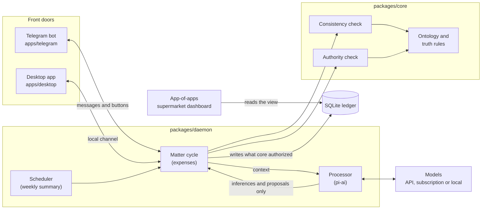

# ANOMANDER

[](https://github.com/Sitray/anomander/actions/workflows/ci.yml)

A personal assistant that understands your world, knows what is true, knows what it may do, and carries a matter to a verifiable result.

> Status: version 0.1.0, run from source (no packaged download). Milestones M0 to M6 of the [PRD](PRD.md) roadmap (§17) are built: see [What works today](#what-works-today) and the [CHANGELOG](CHANGELOG.md). The design is in [`docs/`](docs).

The app speaks English, or Spanish on a computer whose language is Spanish. It runs on macOS and, without a look at the screen or tasks on the computer for now, on Windows. Telegram replies follow `ANOMANDER_LOCALE` (`es` by default for Docker, `en` for English; the Mac app sets it from the system's language), see PRD §12.

To run your own, see [Getting started](#getting-started) (Docker and Telegram), [Run the Mac app](#run-the-mac-app) or [Run the app on Windows](#run-the-app-on-windows).

<!-- screenshot: TODO -->

## What works today

| Where | What works | Spec |
| --- | --- | --- |
| Telegram | Text and receipt expenses, decisions with buttons, corrections, conversation memory, the weekly summary and the morning digest (both off until you ask for them), policies, categories, reminders and tasks, model login (`/login`), the setup guide (`/start`), tasks with connections and an export of your ledger as CSV and JSON files (`/exportar`) | [PRD](PRD.md) M0 to M5f; DK-11 for connections |
| Read API | A token-guarded, GET-only HTTP API over the views `gastos`, `lineas_de_compra` and `pendientes_de_confirmar`, off unless `ANOMANDER_API_TOKEN` is set | [`docs/read-access-prd.md`](docs/read-access-prd.md) (M5b) |
| Mac app | Everything below, with the same daemon, rules and ledger as Telegram | [`docs/desktop-prd.md`](docs/desktop-prd.md) (M6) |

The Mac app:

| Part | What it does | Spec |
| --- | --- | --- |
| Chat and setup | Talk to ANOMANDER in a window; the setup screen keeps the model keys and, if you use Telegram, the bot token in the macOS Keychain | DK-1 to DK-5 |
| Menu bar and notch | The menu bar icon shows a wave while ANOMANDER works. When the work ends, a drop grows out of the notch saying "Ha terminado" and retracts | DK-6 |
| No mode buttons | You just write. From your words the daemon decides whether to look at the screen, act on the computer or use your connections, and says which | DK-13 |
| A look at the screen | Captures the screen and answers about it. The capture is never stored | DK-9 |
| Tasks on the computer | One step at a time, at most 12. A routine step runs; a step of care (Enter, Space, Spotlight, the app switcher, a click on a send, pay or delete control, every fifth step) waits for "Permitir" | DK-10 |
| Connections | MCP servers from `mcp.json` or the Conexiones screen: one "Conectar" for Notion, Linear and Atlassian, or any server by hand under "Avanzado", with OAuth for servers reached by URL. A tool marked read-only runs; any other call waits for "Permitir" | DK-11 |
| Web search | Checked on the first setup, or the "Búsqueda web" card in Conexiones, adds `pi-web-access` (pinned, with its dependencies, in `pnpm-lock.yaml`). "Búscame dónde comprar…" then searches the web instead of using the computer; with no key, searches go to Exa. Reading a page asks first | DK-11 AC11, AC13, DK-13 AC5 |
| Memories and history | Looks and computer tasks know what you told it about yourself. A local history of what it did answers "¿qué hiciste ayer?" and is erased on request | DK-14 |
| The conversation | Kept in the local database, Telegram included, for 90 days: the chat shows it again after you quit the app, and ANOMANDER picks up the last half hour after a restart. It is stored only on your machine (the last turns go to the model provider with each message, as below); "Borrar conversación" or a confirmed "olvida" erases it | DK-16 |
| Subscription login | Connect ChatGPT or Kimi Code from the Suscripciones screen | DK-15 |
| A ledger from Docker | Imports a ledger copied out of a Docker install into the app's empty one | DK-12 |

Not built yet:

- A signed app to download. You build it yourself from this repository; a packaged, notarized app is not planned for now.
- Reminders and summaries in the Mac app without Telegram: they wait until a bot is set up.
- The export in the Mac app: `/exportar` there says to ask for it in Telegram.
- Google Calendar and Drive connectors.

## Vision

ANOMANDER is a personal assistant you can talk to about almost anything and that understands you. "Understanding" has three layers, and each is built differently:

| Layer | What it means | Where it comes from |
| --- | --- | --- |
| Converse | Talk about any topic: questions, explanations, ideas | The model, from day one |
| Know me | Know who I am, what I want and what I told it, separating what I said from what it inferred | The ontology and a memory with epistemic modes |
| Act for me | Carry matters to a verifiable result, within the permissions I grant | Capabilities and permissions, one matter at a time |

The first version has open conversation, a memory with epistemic modes and **a single matter delegated end to end**. Starting with one matter limits what ANOMANDER does, not what you can talk to it about. Each new matter (expenses, calendar, reminders) adds capabilities on the same foundation, and that is how the general assistant grows.

Open conversation follows the same rules as everything else: what I tell it is recorded as declared by me, what it deduces is recorded as inferred, and talking about something does not give it permission to do it.

## Decision and scope

ANOMANDER is defined by what it distinguishes, not by the tools it uses. These documents fix the minimal world it needs and test it against one real matter: **keeping my expenses**. I send it a receipt (or write "23 € cena") and it understands it, organizes it and records it without me having to administer anything.

It is a good first matter because it forces every kind of truth apart: what I declare ("23 € cena"), what is observed (the receipt photo), what ANOMANDER deduces (the total read from the photo, the category) and what ends up confirmed. It also has a clear authority boundary: recording an expense, yes; moving money, never.

Design order, never reversed:

1. World and ontology: what things exist.
2. Truth and authority: who may assert what, and who may authorize what.
3. Capabilities and operations: what the system must be able to do.
4. Providers: which stores, models, databases and apps implement those capabilities.

## How it fits together



The front doors only send messages and show answers. The processor never writes: it returns inferences and proposals. `packages/core` checks consistency and authority as pure functions, and only the daemon's deterministic code writes to the ledger what those checks allowed. The dashboard reads a view and never touches the tables.

## Principles

1. **The model is a processor, not the system.** Claude, Gemini, DeepSeek or a local model are replaceable. ANOMANDER's identity, memory and rules live outside them. If changing the model makes it lose any of that, the design is wrong.
2. **Every assertion carries its epistemic mode.** Observed, declared, inferred and confirmed never mix. An inference does not become a fact because it was stored.
3. **Capability is not permission.** Being technically able to do something does not authorize doing it. Authority is granted by the principal (me), not by the model's confidence.
4. **Apps implement capabilities; they do not define them.** "Notify over Telegram" does not exist in the ontology. "Notify the principal" does, and Telegram is one way to do it.
5. **Only what deserves to survive survives.** The context of an execution dies with it; whatever is kept has a reason and an expiry.
6. **Minimum sufficient.** Each class exists because the workflow needs it. Everything else is added when a real matter asks for it.

## Open source

ANOMANDER is an open-source project in a public repository, released under the [MIT License](LICENSE). That adds four rules to the design:

1. **One principal per installation.** Anyone can deploy their own ANOMANDER; it is not a multi-user service.
2. **Nothing personal in the repository.** Expenses, categories, policies, permissions and the conversation live in the local database; tokens and keys live in a `.env` file that is never committed.
3. **Providers are chosen at install time.** Whoever runs it picks their model (API, subscription or local) and their front door; the core assumes none.
4. **The ontology is public.** These documents are the specification: every contribution must respect it, and any app can be built on top of it.

## What leaves your machine

Your data stays on the machine that runs ANOMANDER, except for what goes to these places:

| Where it goes | What goes there |
| --- | --- |
| The model provider you chose | What you write, the last turns of the conversation (at most 10, from the last 30 minutes), your memories, the recent history of what ANOMANDER did, the tools of your connections, receipt photos, and the screen capture of a look at the screen or of a task on the computer |
| Telegram, if you set up a bot | Your messages and receipt photos to the bot, and its replies and reminders |
| Exa (exa.ai), if web search is on | What ANOMANDER searches for, with no account. Another search engine or a proxy asks first; pages are read from your machine, after "Permitir" |
| The servers you connect (Notion, Linear, Atlassian or your own) | The calls ANOMANDER makes to their tools. A tool marked read-only runs without asking; any other call waits for "Permitir" |
| Apps holding your read API token | The views `gastos`, `lineas_de_compra` and `pendientes_de_confirmar`. Off unless `ANOMANDER_API_TOKEN` is set; an address off the machine also needs `ANOMANDER_API_ALLOW_PLAIN_HTTP=1` |

What stays local:

- The data folder: the SQLite database (expenses, categories, policies, memories, the conversation for 90 days and the history of what ANOMANDER did) and the receipt photos, readable by their owner only.
- Secrets: in the macOS Keychain or the Windows Credential Manager for the app, in `.env` and the login file at `ANOMANDER_AUTH_PATH` for Docker.
- Screen captures and receipt images in the conversation are never stored: a receipt is kept as its `[foto de ticket]` line. "Borrar conversación", a confirmed "olvida" and the 90-day retention erase the conversation for real.

See [PRD](PRD.md) §16 for the full rules.

## Getting started

This runs the daemon with Docker, reached over Telegram. For the Mac app, see [Run the Mac app](#run-the-mac-app).

You need Docker, a Telegram account and a model: an API key, or a ChatGPT or Kimi Code subscription.

1. **Create the bot.** In Telegram, send `/newbot` to [@BotFather](https://t.me/BotFather) and pick a name. It answers with a token such as `123456:ABC…`.
2. **Find your user ID.** Send any message to [@userinfobot](https://t.me/userinfobot). It answers with your `Id`, a number. The bot will serve only that ID.
3. **Fill in `.env`.**
   ```bash
   cp .env.example .env
   ```
   Then set these lines. This example uses Gemini; any provider-qualified model works (see [Connecting a model](#connecting-a-model)):
   ```env
   TELEGRAM_BOT_TOKEN=<token from @BotFather>
   ANOMANDER_PRINCIPAL_CHAT_ID=<your Id>
   ANOMANDER_MODEL=google/gemini-2.5-flash
   ANOMANDER_VISION_MODEL=google/gemini-2.5-flash
   GEMINI_API_KEY=<your key>
   ```
   With a subscription instead of a key, leave the key out and connect it in step 5. The other variables have working defaults.
4. **Start it.**
   ```bash
   docker compose up -d --build
   docker compose logs -f daemon
   ```
   The log should end with `anomander is listening on Telegram`. If the token or your ID is missing, the log says where to get it.
5. **Say hello.** Send `/start` to your bot. It answers `¡Hola!` when everything is set, or lists what is still missing. Send `/login` to connect a subscription.

Good to know:

| Situation | What to do |
| --- | --- |
| You changed `.env` | `docker compose up -d --force-recreate`; a plain `restart` does not reread it. |
| Something does not answer | `docker compose logs --tail 30 daemon`. Logs never contain your messages, tokens or keys. |
| You want to look at your data | The database lives in the Docker volume `anomander-data`. Copy it into the git-ignored `data/` folder with `docker compose cp daemon:/app/data/anomander.db ./data/anomander-copy.db`, so the copy can never be committed. |

## Run the Mac app

There is no download yet: you build the app from this repository, on your Mac. It starts the same daemon as Docker, so stop a Docker install first: two daemons on one bot fail (DK-2 AC2).

You need:

| What | Why |
| --- | --- |
| macOS | The app uses the Keychain, the menu bar and the notch. For Windows, see [Run the app on Windows](#run-the-app-on-windows); there is no Linux app |
| Node 24 and pnpm | The app runs the daemon with the first `node` on `PATH` (plus `/opt/homebrew/bin` and `/usr/local/bin`) |
| Rust 1.85 or later and the Xcode Command Line Tools | To build the Tauri shell |
| A code-signing identity | macOS ties each Keychain entry to the app's signature. An unsigned build gets a new one each time, so after every rebuild macOS asks for your login keychain password |
| A Telegram bot and your user ID, if you want | Only to talk to ANOMANDER over Telegram too ([Getting started](#getting-started), steps 1 and 2). Without them the app's chat works on its own |
| A model | An API key, or a ChatGPT or Kimi Code subscription |

Steps:

1. **Install.** From the repository root: `pnpm install`.
2. **Pick an identity.** `security find-identity -v -p codesigning` lists them.
3. **Build.**
   ```bash
   APPLE_SIGNING_IDENTITY="<identity name or hash>" pnpm --dir apps/desktop tauri build --debug
   ```
   The app is `apps/desktop/src-tauri/target/debug/bundle/macos/ANOMANDER.app`.
4. **Set it up.** Open the app and fill in the setup screen: the models and a key, or connect a subscription from Suscripciones. Telegram is optional: add the bot token and your Telegram ID to talk to ANOMANDER there too, or leave both empty to use the app's chat alone. "Búsqueda web" comes checked: leave it so to let ANOMANDER search the internet (the note beside it says what leaves the Mac), or uncheck it and add it later from Conexiones.
5. **Allow it.** In System Settings › Privacy & Security, turn ANOMANDER on under Screen Recording (for a look at the screen) and Accessibility (for tasks on the computer). Until then the app says how and does nothing.

Good to know:

| Situation | What to do |
| --- | --- |
| You moved or deleted this checkout | Build again. The app runs the daemon from `packages/daemon/src/main.ts` of the checkout it was built in |
| You want to work on the window | `pnpm --dir apps/desktop tauri dev`, or the window alone in a browser. See [`apps/desktop/README.md`](apps/desktop/README.md) |
| macOS asks for the keychain password once | Entries stored by an unsigned build ask once. [`apps/desktop/README.md`](apps/desktop/README.md#signing-the-build) says how to clear them |

## Run the app on Windows

The same app, built from this repository on your Windows PC, with the chat, the setup, connections, subscription login and Telegram. A look at the screen and tasks on the computer are macOS-only for now: on Windows the app answers them with its macOS permission message. As on the Mac, stop a Docker install first (DK-2 AC2).

You need:

| What | Why |
| --- | --- |
| Windows 10 or 11, 64-bit, with the WebView2 runtime | The window is drawn by WebView2. Windows 11 has it; on Windows 10 the installer fetches it |
| Node 24 and pnpm | The app runs the daemon with the first `node.exe` on `PATH` |
| Rust 1.85 or later with the MSVC toolchain (`rustup default stable-x86_64-pc-windows-msvc`) and the Visual Studio Build Tools with "Desktop development with C++" | To build the Tauri shell |
| A model | An API key, or a ChatGPT or Kimi Code subscription |

Steps, in a terminal (PowerShell or Git Bash):

1. **Install.** From the repository root: `pnpm install`.
2. **Build.**
   ```bash
   pnpm --dir apps/desktop tauri build --bundles nsis
   ```
   The installer is `apps/desktop/src-tauri/target/release/bundle/nsis/ANOMANDER_0.1.0_x64-setup.exe`. It is not signed, so SmartScreen asks before it runs: choose "More info" › "Run anyway". `apps/desktop/src-tauri/target/release/anomander-desktop.exe` runs the app without installing it. A `--debug` build is quicker to make but opens a console window beside the app.
3. **Set it up.** As on the Mac (step 4 above). The secrets go to the Windows Credential Manager.

Good to know:

| Situation | What to do |
| --- | --- |
| Where the app is | In the notification area of the taskbar (it may be under the "^" arrow). A click opens the chat; the right button opens the menu. Closing the window leaves the app there |
| Where its files are | The data in `%APPDATA%\ANOMANDER`, the log in `%LOCALAPPDATA%\dev.anomander.desktop\logs\anomander.log` |
| You moved or deleted this checkout | Build again, as on the Mac |
| Checking it by hand | [`docs/windows-check.md`](docs/windows-check.md) lists what to try |

## Connecting a model

ANOMANDER reaches its model through [pi-ai](https://github.com/earendil-works/pi), either way:

- **An API key** in `.env`, in the provider's own variable (for example `ANTHROPIC_API_KEY` or `OPENAI_API_KEY`). This is the only way for providers without a subscription login, such as opencode, Gemini or DeepSeek.
- **Your subscription**: ChatGPT or Kimi Code. Send `/login` to the bot and follow the link, or run `pnpm run login` in a terminal on the server. `/logout` or `pnpm run logout <provider>` disconnects it. A login takes precedence over that provider's API key. In the Mac app, connect it from the Suscripciones screen instead: the app keeps it in the Keychain (DK-15).

Logins are stored in the file at `ANOMANDER_AUTH_PATH` (default `./data/auth.json`), readable only by its owner and never committed. See [`packages/daemon/README.md`](packages/daemon/README.md#model-login-r-27).

Each provider sets its own terms for using a subscription outside its own apps. Check them before connecting an account.

## Documentation

The documentation lives in `docs/`, beside each package's README:

| File | Contents |
| --- | --- |
| `README.md` (this file) | Status, vision, scope, principles, open source and how to run it |
| [`PRD.md`](PRD.md) | Product requirements, ready to use with Gentle AI and its ODD workflow |
| [`docs/ontology.md`](docs/ontology.md) | The classes, who owns each truth, provenance and lifecycle |
| [`docs/authority.md`](docs/authority.md) | Authority levels, capabilities and operations |
| [`docs/workflows/expenses.md`](docs/workflows/expenses.md) | The full cycle of the first matter |
| [`docs/data-model.md`](docs/data-model.md) | The SQLite schema and the views readers use |
| [`docs/stack.md`](docs/stack.md) | Stack, repository layout, tests, Docker and providers |
| [`docs/decisions.md`](docs/decisions.md) | What is out of scope, the size of the ontology and the decisions taken |
| [`docs/capabilities.md`](docs/capabilities.md) | How a capability is added, and what the Mac app can do on its own routes |
| [`docs/desktop-prd.md`](docs/desktop-prd.md) | The Mac app (M6): requirements DK-1 to DK-15 |
| [`docs/read-access-prd.md`](docs/read-access-prd.md) | The read API for other applications (M5b) |
| [`apps/desktop/README.md`](apps/desktop/README.md) | How the Mac app is built and what it guarantees |
| [`packages/daemon/README.md`](packages/daemon/README.md) | How the daemon is built and configured |
