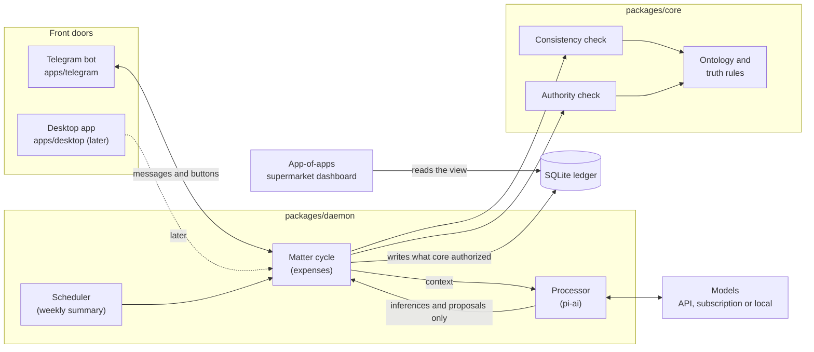

# ANOMANDER

A personal assistant that understands your world, knows what is true, knows what it may do, and carries a matter to a verifiable result.

> Status: in development. Milestones M0 to M3b of the [PRD](PRD.md) roadmap (§17) are built: text and receipt expenses over Telegram, decisions, corrections and conversation memory; M4 (weekly summary, policies, categories) is next. The design is in [`docs/`](docs).

## Vision

ANOMANDER is a personal assistant you can talk to about almost anything and that understands you. "Understanding" has three layers, and each is built differently:

| Layer | What it means | Where it comes from |
| --- | --- | --- |
| Converse | Talk about any topic: questions, explanations, ideas | The model, from day one |
| Know me | Know who I am, what I want and what I told it, separating what I said from what it inferred | The ontology and a memory with epistemic modes |
| Act for me | Carry matters to a verifiable result, within the permissions I grant | Capabilities and permissions, one matter at a time |

The first version has open conversation, a memory with epistemic modes and **a single matter delegated end to end**. Starting with one matter limits what ANOMANDER does, not what you can talk to it about. Each new matter (expenses, calendar, reminders) adds capabilities on the same foundation, and that is how the general assistant grows.

Open conversation follows the same rules as everything else: what I tell it is recorded as declared by me, what it deduces is recorded as inferred, and talking about something does not give it permission to do it.

## Decision and scope

ANOMANDER is defined by what it distinguishes, not by the tools it uses. These documents fix the minimal world it needs and test it against one real matter: **keeping my expenses**. I send it a receipt (or write "23 € cena") and it understands it, organizes it and records it without me having to administer anything.

It is a good first matter because it forces every kind of truth apart: what I declare ("23 € cena"), what is observed (the receipt photo), what ANOMANDER deduces (the total read from the photo, the category) and what ends up confirmed. It also has a clear authority boundary: recording an expense, yes; moving money, never.

Design order, never reversed:

1. World and ontology: what things exist.
2. Truth and authority: who may assert what, and who may authorize what.
3. Capabilities and operations: what the system must be able to do.
4. Providers: which stores, models, databases and apps implement those capabilities.

## How it fits together

The front doors only send messages and show answers. The processor never writes: it returns inferences and proposals. `packages/core` checks consistency and authority as pure functions, and only the daemon's deterministic code writes to the ledger what those checks allowed. The dashboard reads a view and never touches the tables.

## Principles

1. **The model is a processor, not the system.** Claude, Gemini, DeepSeek or a local model are replaceable. ANOMANDER's identity, memory and rules live outside them. If changing the model makes it lose any of that, the design is wrong.
2. **Every assertion carries its epistemic mode.** Observed, declared, inferred and confirmed never mix. An inference does not become a fact because it was stored.
3. **Capability is not permission.** Being technically able to do something does not authorize doing it. Authority is granted by the principal (me), not by the model's confidence.
4. **Apps implement capabilities; they do not define them.** "Notify over Telegram" does not exist in the ontology. "Notify the principal" does, and Telegram is one way to do it.
5. **Only what deserves to survive survives.** The context of an execution dies with it; whatever is kept has a reason and an expiry.
6. **Minimum sufficient.** Each class exists because the workflow needs it. Everything else is added when a real matter asks for it.

## Open source

ANOMANDER is an open-source project in a public repository, released under the [MIT License](LICENSE). That adds four rules to the design:

1. **One principal per installation.** Anyone can deploy their own ANOMANDER; it is not a multi-user service.
2. **Nothing personal in the repository.** Expenses, categories, policies and permissions live in the local database; tokens and keys live in a `.env` file that is never committed.
3. **Providers are chosen at install time.** Whoever runs it picks their model (API, subscription or local) and their front door; the core assumes none.
4. **The ontology is public.** These documents are the specification: every contribution must respect it, and any app can be built on top of it.

## Documentation

As in gentle-dot, the documentation lives in a `docs/` folder:

| File | Contents |
| --- | --- |
| `README.md` (this file) | Vision, scope, principles and open source |
| [`PRD.md`](PRD.md) | Product requirements, ready to use with Gentle AI and its ODD workflow |
| [`docs/ontology.md`](docs/ontology.md) | The classes, who owns each truth, provenance and lifecycle |
| [`docs/authority.md`](docs/authority.md) | Authority levels, capabilities and operations |
| [`docs/workflows/expenses.md`](docs/workflows/expenses.md) | The full cycle of the first matter |
| [`docs/data-model.md`](docs/data-model.md) | The SQLite schema and the dashboard view |
| [`docs/stack.md`](docs/stack.md) | Stack, repository layout, tests, Docker and providers |
| [`docs/decisions.md`](docs/decisions.md) | What is out of scope, the size of the ontology and the decisions taken |
