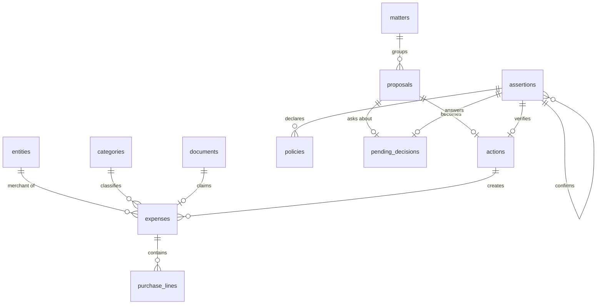

# Data model

The schema follows from the 16 data classes of the [ontology](ontology.md). The core idea: **an append-only ledger of assertions** (`assertions`) and, on top of it, tables of what is currently believed (`expenses`, `purchase_lines`) that always state their mode. A stored inference is still an inference, because its mode travels with it.

The database is one SQLite file, opened with `PRAGMA journal_mode = WAL`, `PRAGMA foreign_keys = ON` and `PRAGMA recursive_triggers = ON` (without it, `REPLACE` would bypass the ledger triggers).

How the tables relate:



`assertions` also points to any subject (an expense, a purchase line, a document) through `subject_type` and `subject_id`; that link is not drawn because it is polymorphic. `permissions` is read by the authority check and referenced as `permission:<id>` in `actions.authorized_by`.

```sql
-- World
CREATE TABLE entities (
  id INTEGER PRIMARY KEY,
  kind TEXT NOT NULL CHECK (kind IN ('principal', 'merchant')),
  name TEXT NOT NULL,
  created_at TEXT NOT NULL
);

CREATE TABLE categories (           -- created only by the principal
  id INTEGER PRIMARY KEY,
  name TEXT NOT NULL UNIQUE CHECK (name = lower(name)),  -- 'supermercado', 'restaurantes'
  created_at TEXT NOT NULL
);

CREATE TABLE documents (            -- the receipt; images are temporary (R-8)
  id INTEGER PRIMARY KEY,
  kind TEXT NOT NULL CHECK (kind IN ('receipt')),
  received_at TEXT NOT NULL,
  source TEXT NOT NULL,             -- 'telegram:<message_id>' or 'telegram:album:<media_group_id>'
  image_count INTEGER NOT NULL DEFAULT 1,
  status TEXT NOT NULL CHECK (status IN ('queued', 'read', 'unreadable', 'discarded')),
  keep_until TEXT,                  -- set only while queued (R-8 AC2)
  image_deleted_at TEXT
);

-- Truth: append-only ledger; only status may change
CREATE TABLE assertions (
  id INTEGER PRIMARY KEY,
  subject_type TEXT NOT NULL,       -- 'expense', 'purchase_line', 'document'...
  subject_id INTEGER,
  predicate TEXT NOT NULL,          -- 'total', 'merchant', 'category', 'line'...
  value_json TEXT NOT NULL,
  mode TEXT NOT NULL CHECK (mode IN ('observed', 'declared', 'inferred', 'confirmed')),
  actor TEXT NOT NULL CHECK (actor IN ('principal', 'source', 'code', 'processor')),
  source TEXT NOT NULL,
  basis_json TEXT,                  -- what an inference rests on
  confidence REAL,
  valid_at TEXT,
  expires_at TEXT,
  status TEXT NOT NULL CHECK (status IN ('current', 'confirmed', 'refuted', 'expired')),
  supersedes_id INTEGER REFERENCES assertions(id),
  confirms_id INTEGER REFERENCES assertions(id),   -- set only when mode = 'confirmed'
  created_at TEXT NOT NULL,
  CHECK ((mode = 'confirmed') = (confirms_id IS NOT NULL))
);

CREATE TRIGGER assertions_no_delete
BEFORE DELETE ON assertions
BEGIN
  SELECT RAISE(ABORT, 'assertions are append-only');
END;

CREATE TRIGGER assertions_status_only
BEFORE UPDATE ON assertions
WHEN NEW.id IS NOT OLD.id
  OR NEW.subject_type IS NOT OLD.subject_type
  OR NEW.subject_id IS NOT OLD.subject_id
  OR NEW.predicate IS NOT OLD.predicate
  OR NEW.value_json IS NOT OLD.value_json
  OR NEW.mode IS NOT OLD.mode
  OR NEW.actor IS NOT OLD.actor
  OR NEW.source IS NOT OLD.source
  OR NEW.basis_json IS NOT OLD.basis_json
  OR NEW.confidence IS NOT OLD.confidence
  OR NEW.valid_at IS NOT OLD.valid_at
  OR NEW.expires_at IS NOT OLD.expires_at
  OR NEW.supersedes_id IS NOT OLD.supersedes_id
  OR NEW.confirms_id IS NOT OLD.confirms_id
  OR NEW.created_at IS NOT OLD.created_at
BEGIN
  SELECT RAISE(ABORT, 'only assertions.status may change');
END;

-- Currently believed, with mode
CREATE TABLE expenses (
  id INTEGER PRIMARY KEY,
  merchant_id INTEGER REFERENCES entities(id),
  occurred_on TEXT NOT NULL,
  total_cents INTEGER NOT NULL,
  currency TEXT NOT NULL DEFAULT 'EUR',
  category_id INTEGER REFERENCES categories(id),   -- NULL = uncategorized
  category_basis TEXT CHECK (category_basis IN ('declared', 'policy', 'inferred')),
  mode TEXT NOT NULL CHECK (mode IN ('declared', 'inferred', 'corroborated', 'confirmed')),
  document_id INTEGER REFERENCES documents(id),    -- NULL for text expenses
  status TEXT NOT NULL CHECK (status IN ('pending', 'current', 'refuted')),
  created_by_action_id INTEGER REFERENCES actions(id),
  created_at TEXT NOT NULL
);

CREATE TABLE purchase_lines (
  id INTEGER PRIMARY KEY,
  expense_id INTEGER NOT NULL REFERENCES expenses(id),
  product_name TEXT NOT NULL,       -- as printed on the receipt
  quantity REAL NOT NULL DEFAULT 1,
  amount_cents INTEGER NOT NULL
);

-- Work and knowledge
CREATE TABLE matters (
  id INTEGER PRIMARY KEY,
  title TEXT NOT NULL,              -- 'Keep my expenses'
  status TEXT NOT NULL CHECK (status IN ('open', 'active', 'waiting', 'resolved', 'abandoned')),
  opened_at TEXT NOT NULL,
  closed_at TEXT
);

CREATE TABLE policies (             -- declared only by the principal
  id INTEGER PRIMARY KEY,
  rule_json TEXT NOT NULL,          -- {"merchant": "Mercadona", "category": "supermercado"}
  declared_by_assertion_id INTEGER NOT NULL REFERENCES assertions(id),
  active INTEGER NOT NULL DEFAULT 1,
  created_at TEXT NOT NULL,
  revoked_at TEXT
);

-- Operations
CREATE TABLE permissions (          -- granted only by the principal
  id INTEGER PRIMARY KEY,
  operation TEXT NOT NULL,          -- 'register_expense'
  conditions_json TEXT NOT NULL,    -- {"lines_sum_to_total": true, "category_basis": "policy"}
  limits_json TEXT,
  granted_at TEXT NOT NULL,
  expires_at TEXT,
  revoked_at TEXT
);

CREATE TABLE proposals (
  id INTEGER PRIMARY KEY,
  matter_id INTEGER REFERENCES matters(id),
  operation TEXT NOT NULL,
  payload_json TEXT NOT NULL,
  basis_json TEXT,
  status TEXT NOT NULL CHECK (status IN ('proposed', 'authorized', 'asked', 'rejected', 'executed')),
  created_at TEXT NOT NULL
);

CREATE TABLE pending_decisions (
  id INTEGER PRIMARY KEY,
  proposal_id INTEGER REFERENCES proposals(id),
  question TEXT NOT NULL,
  options_json TEXT NOT NULL,       -- ["Apuntar", "Corregir", "Descartar"]
  status TEXT NOT NULL CHECK (status IN ('open', 'awaiting_text', 'answered', 'expired')),
  channel_ref TEXT,                 -- the message that shows it, e.g. 'telegram:<message_id>' (R-17 AC2)
  awaiting_since TEXT,              -- set while status = 'awaiting_text' (R-17 AC6)
  answer_assertion_id INTEGER REFERENCES assertions(id),
  created_at TEXT NOT NULL
);

-- At most one decision waits for text at a time (R-17 AC3)
CREATE UNIQUE INDEX one_awaiting_text
  ON pending_decisions (status) WHERE status = 'awaiting_text';

CREATE TABLE actions (
  id INTEGER PRIMARY KEY,
  proposal_id INTEGER NOT NULL REFERENCES proposals(id),
  authorized_by TEXT NOT NULL,      -- 'permission:<id>' or 'principal'
  executed_at TEXT NOT NULL,
  status TEXT NOT NULL CHECK (status IN ('executed', 'verified', 'failed')),
  verification_assertion_id INTEGER REFERENCES assertions(id)
);

-- Read by the app-of-apps supermarket dashboard
CREATE VIEW supermarket_purchases AS
SELECT
  l.product_name AS producto,
  l.quantity     AS cantidad,
  l.amount_cents AS precio_cents,
  m.name         AS comercio,
  e.occurred_on  AS fecha,
  e.mode         AS modo
FROM purchase_lines l
JOIN expenses e   ON e.id = l.expense_id
JOIN entities m   ON m.id = e.merchant_id
JOIN categories c ON c.id = e.category_id
WHERE c.name = 'supermercado'
  AND e.status = 'current';
```

The daily AI budget (PRD R-12) has its own table, added by the migration `0003_ai_budget.sql`:

```sql
-- Daily AI budget (R-12): processor calls per day in TZ
CREATE TABLE ai_usage (
  day TEXT PRIMARY KEY,             -- 'YYYY-MM-DD' in TZ
  calls INTEGER NOT NULL,           -- processor calls counted that day (R-12 AC1)
  limit_notified INTEGER NOT NULL DEFAULT 0  -- 1 once S-10 was sent that day (R-12 AC2)
);
```

Schema decisions:

- **Money is stored in cents** (`INTEGER`), never as decimals, so that sums add up exactly.
- **Nothing is deleted or overwritten in `assertions`.** A correction of mine creates a new assertion that points to the earlier one (`supersedes_id`) and marks it as refuted. Two triggers enforce it: only `status` may change, and no row may be deleted.
- **A confirmation points at what it confirms** (`confirms_id`). Its actor is `principal` when I confirm, or `code` when a deterministic check corroborates the assertion.
- **Receipt images are temporary.** `documents.status` and `keep_until` track the queue used when the daily AI budget runs out (PRD R-8, R-12).
- **The daily AI budget is counted in the database** (`ai_usage`, one row per day in `TZ`), so a restart does not reset it, and `limit_notified` makes the limit notice go out once a day (PRD R-12).
- **At most one pending decision waits for my text** (`awaiting_text`), enforced by a partial unique index (PRD R-17).
- **The database does not stop the processor from writing "confirmed"; the code does.** The processor never writes directly: it returns inferences and proposals, and only the code that checks authority turns them into rows.
- **The dashboard only reads the view.** It never touches the tables, so changing the internal schema does not break the app of apps as long as the view keeps returning the same columns.
- **Category names and view columns are in Spanish** because they are the principal's own scheme and the dashboard's labels. The rest of the schema is in English.
