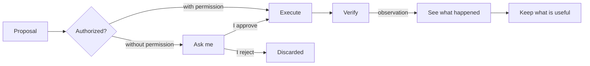

# Ontology

What exists in ANOMANDER's world, who may assert each thing, where it comes from and how long it lasts.

## Classes

Twenty-six classes in six layers. Each one is here because the expenses workflow needs it; the example in the last column shows how.

| Layer | Class | Meaning | In the workflow |
| --- | --- | --- | --- |
| World | Principal | The person ANOMANDER serves and the only source of authority | Me |
| World | External entity | Something outside ANOMANDER that acts or informs: a merchant, a bank, another person | Mercadona |
| World | Document | An object containing someone else's claims; it is not true by itself | A receipt photo |
| World | Expense | An economic fact: I paid an amount to someone on a date | 23,40 € at Mercadona on 29 October |
| World | Purchase line | A product within an expense: its name as printed on the receipt, quantity and amount | "LECHE ENTERA 1L × 2, 1,78 €" |
| World | Category | A kind of expense within my own scheme, defined by me | Supermercado, restaurantes |
| Truth | Assertion | A statement that something is so at a point in time, with its epistemic mode | "The receipt total is 23,40 €" |
| Truth | Observation | An assertion recorded directly from a source, without interpretation | "I received this image at 21:05" |
| Truth | Declaration | An assertion someone made; it is worth what its author is worth | "23 € cena" |
| Truth | Inference | An assertion produced by a processor, with its basis and its confidence | "The total is 23,40 €", read from the photo; "it is supermercado" |
| Truth | Confirmation | An act that validates an assertion: I do it, or a deterministic check corroborates it | "Yes, that's right"; the lines add up to the total |
| Truth | Source | Where an assertion came from, with its reliability | A message from me; the receipt |
| Work | Goal | A state of the world the principal wants | Know what I spend each month |
| Work | Preference | A lasting constraint on how to reach it | My categories; a summary on Sundays |
| Work | Matter | A goal delegated to ANOMANDER, with its own state; it is the unit of delegation | "Keep my expenses" |
| Work | Pending decision | A question only the principal can answer | "I can't read the total clearly. Is it 23,40 € or 28,40 €?" |
| Knowledge | Policy | A rule declared by the principal about how ANOMANDER should behave | "Mercadona is always supermercado" |
| Knowledge | Pattern | An inferred generalization; a proposal until the principal turns it into a policy | "On Friday nights you usually eat out" |
| Operations | Capability | A kind of thing ANOMANDER knows how to do, without naming how | Read a document |
| Operations | Permission | A grant from the principal: which capability, with what scope, limits and expiry | Register without asking if the lines add up to the total |
| Operations | Proposal | An action ANOMANDER wants to take and has not taken yet | "Register 23,40 € at Mercadona as supermercado" |
| Operations | Action | An executed operation, with who authorized it | The registered expense |
| Runtime | Execution | One cycle with a start and an end | Processing one receipt |
| Runtime | Working context | What matters only during an execution; it dies with it | The raw extracted text, the intermediate reasoning |
| Runtime | Processor | Code or a model that transforms information; it only produces inferences and proposals | A vision model reading the receipt |
| Runtime | Provider | A concrete implementation of a capability | Telegram; the vision model |

The key to this matter is the **Document** class: a receipt is not an expense, it is an object that *claims* an expense happened. What ANOMANDER extracts from it is inference until something confirms it. There is no "Result" class: the result of an action is an **observation** about that action. There is no "Memory" class either: memory is the set of assertions and policies that survive, each with its mode and its expiry.

Reminders and tasks (PRD R-25) add no class: each one is a **declaration** of the principal, an assertion with predicate `reminder` about the reminder, and creating one is an **action** the principal's own message authorizes. They are the first **capability** that is not about expenses (see [capabilities](capabilities.md)).

Left out for now, because the workflow does not need them: budgets, bank accounts, projects, obligations, relationships between people, and places.

## Who owns each truth

Four actors can touch the system, and each has a different role. The processor (the LLM) is the most capable and the one with the least authority.

| Class | Principal (me) | External source | Deterministic code | Processor (LLM) |
| --- | --- | --- | --- | --- |
| Observation | Does not create it | Originates it | Records it | Never |
| Declaration | Creates it | Creates it (as a third party) | Records it | Never on anyone's behalf |
| Inference | May refute it | No | May produce it (calculations) | Produces it |
| Confirmation | Gives it | Only with authority over that datum | Corroborates it (checks) | Never |
| Goal, Preference, Policy | Creates, changes and retires them | No | Stores them | Only proposes them |
| Matter | Opens and closes it | No | Tracks its state | Proposes state changes |
| Pending decision | Answers it | No | Raises it | Formulates it |
| Pattern | Turns it into a policy or discards it | No | Proposes it (for expenses, by counting, PRD R-13 AC2) | May propose it (not used for expenses) |
| Permission | Grants, limits and revokes it | No | Checks it | Never, not even for itself |
| Action | Authorizes it (or a permission covers it) | No | Executes and verifies it | Proposes it |

Four rules follow from this table:

1. **The LLM does not observe.** The receipt photo is an observation; the total the model reads from it is an inference, however confident the model is. Only what is recorded without interpretation (the image, my message, the time) is an observation.
2. **An inference moves up in only two ways:** I confirm it, or a deterministic check corroborates it (the lines add up to the total, the date is valid). Storing it changes nothing.
3. **Nobody grants authority to themselves.** Neither the LLM nor the code creates permissions; they only check them.
4. **On my own expenses, my declaration rules.** If I write "23 € cena", the amount is mine and needs no further proof. The category, however, is still an inference unless I state it or it comes from one of my policies.

## Provenance and lifecycle

Every stored assertion carries seven fields. Without them it is not stored.

| Field | What it says | Example |
| --- | --- | --- |
| Mode | Observed, declared, inferred or confirmed | Inferred |
| Who | The actor that produced it | Processor: vision model |
| Source | Where it came from | The receipt photo sent over Telegram |
| When | The moment it was true | 2026-10-29, the date printed on the receipt |
| Basis | For inferences: what it rests on and with what confidence | The "TOTAL 23,40" line on the receipt; the lines add up to 23,40 |
| Validity | How long it matters | Indefinite for the expense; 30 days for an unconfirmed inference |
| Status | Current, confirmed, refuted or expired | Confirmed by corroboration |

Lifecycles:

- **Assertion:** born in its mode. An inference can become confirmed (I validate it or a deterministic check corroborates it), refuted or expired. It never changes mode silently. A confirmation is a new assertion that points at what it confirms (PRD §7.2).
- **Matter:** open → active → waiting for a decision (when there is a pending decision) → resolved or abandoned. Only I open and close it; matters do not expire in v1.
- **Permission:** granted → active → revoked or expired. A permission with no expiry can still be revoked at any time.
- **Action:** the cycle in the diagram below.

The authority check is code, not a model step. If there is no permission, the action becomes a pending decision; if I reject it, it is discarded. Verifying means observing what actually happened, not assuming the action worked.
