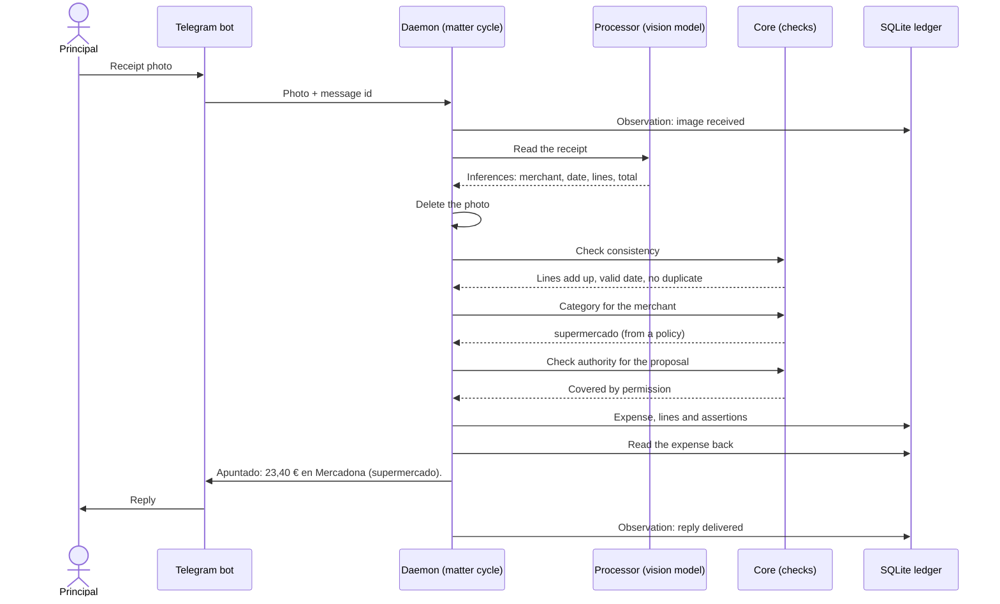

# Workflow: keeping my expenses

The first matter delegated end to end. I send a photo of a Mercadona receipt over Telegram; this is the full cycle, with what is created at each step. A message such as "23 € cena" follows the same path but shorter: the processor interprets the text (step 2) and code checks that the amount it extracted is written literally in my message, but the receipt checks of step 3 do not apply, because the amount is my declaration.

| Step | What happens | What is created or changes | Who decides |
| --- | --- | --- | --- |
| 1. Observe | The photo arrives | Observation: the image, with source "principal message" and time | Nobody |
| 2. Interpret | The processor reads the receipt | Inferences: merchant, date, lines, total and payment method, with their basis | Processor (proposes) |
| 3. Check consistency | The code adds up the lines, validates the date and looks for duplicates | If everything checks out, the inferences are corroborated; if not, the failing check is recorded | Code |
| 4. Relate to my state | Looks for a policy for the merchant; if there is none, infers the category | Category derived from a policy ("Mercadona is supermercado") or inferred | Code and processor |
| 5. Decide | Proposes registering the expense | Proposal: 23,40 €, Mercadona, supermercado, 29 October | Processor (proposes) |
| 6. Check authority | Does my "register if it adds up" permission cover this? | If it adds up and the category comes from a policy: authorized action. If not: pending decision with buttons (Apuntar / Corregir / Descartar) | Code; me if needed |
| 7. Act | Registers the expense and its lines | Executed action; current expense with its provenance | Code |
| 8. Verify | Reads the record back and confirms to me what was recorded | Observation about the action; the message "Apuntado: 23,40 € en Mercadona (supermercado)." | Code |
| 9. Retain | Decides what survives | See below | Code |
| 10. Inform (Sundays) | Summarizes the week by category | Action under permission; the code computes the totals, the model only writes the text | Code and processor |

The same cycle as a sequence, for a receipt that adds up and a merchant with a policy:

When a check fails or no permission covers the proposal, the core returns "ask" instead. The daemon stores the expense as `pending` (never current), with its proposal and the pending decision, and the bot shows the decision with its buttons. "Apuntar" makes the expense current; "Descartar" refutes it.

The bot speaks Spanish in v1. The exact user-facing strings are listed in the [PRD](../../PRD.md) (§12).

**What survives:**

- The expense, with its mode (declared, corroborated or confirmed by me) and its provenance.
- The purchase lines of each expense, because they feed the supermarket dashboard.
- My declarations, confirmations and corrections. A correction of mine refutes the earlier inference; it does not delete it.
- The inferences that ended up in a registered expense; the rest expire after 30 days.
- A proposed pattern, if there is one ("you always file Mercadona as supermercado"), marked as a proposal until I turn it into a policy.

**What dies:** the receipt photo (deleted as soon as the data is extracted), the raw extracted text, the intermediate reasoning and any unused inference. Without the photo a misread receipt cannot be read again; I accept that in exchange for not storing images.

**The proof that it works:** I send the photo and do nothing else. ANOMANDER only asks me when the receipt does not add up or the merchant is new, and on Sunday I get a summary whose figures I can trace back to each receipt.
